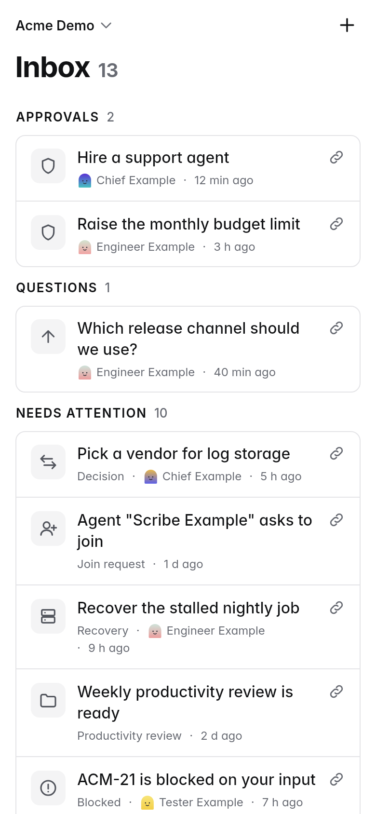
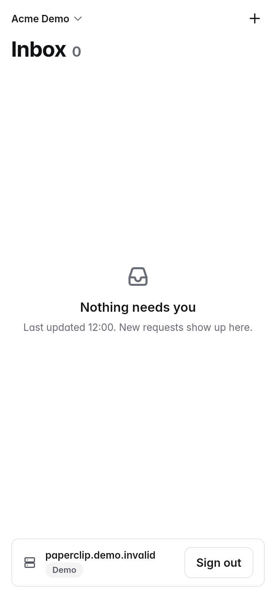
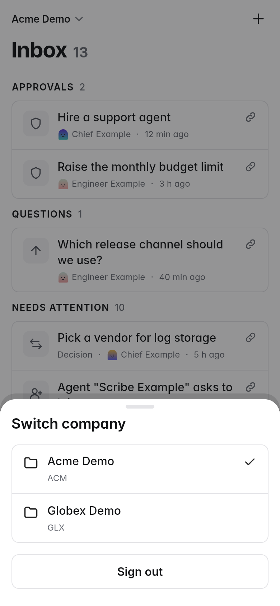

# Paperplane

Paperplane is an unofficial, community-built mobile client for Paperclip. It is not affiliated with or endorsed by the Paperclip project.

A free, open-source mobile app (iOS, iPadOS, Android) for a self-hosted
[Paperclip](https://github.com/paperclipai/paperclip). Built with Flutter.

**Status: early (milestones M1/M2).** Sign in to your self-hosted Paperclip
server with email and password, or paste an existing board key. Then see the
live **Inbox** (what is waiting on you, grouped Approvals / Questions / Needs
attention) and use the **company switcher**. A built-in **demo mode** needs no
server. Approving, answering, replying and creating issues are **not built
yet**: tapping a row opens the item in your browser.

Principles: no telemetry, no push notifications, no background fetch. The app
talks only to the Paperclip server you sign in to.

## Screenshots

*Rendered* by Flutter's test renderer from demo data, not taken on a device
(no iOS simulator was available). iPhone 390×844 (left) and iPad 820×1180.

| Inbox | Empty | Company switcher |
|---|---|---|
|  |  |  |

iPad: [Inbox](docs/screenshots/s2-inbox-tablet.png),
[empty](docs/screenshots/s2-inbox-empty-tablet.png),
[switcher](docs/screenshots/s3-switcher-tablet.png). Regenerate with
`PAPERPLANE_SCREENSHOTS=1 fvm flutter test test/screenshots_test.dart`.

## Known limits

- **No notifications while the app is closed.** The Inbox refreshes when you
  open the app, when you pull down, and about every 30 s while it is on
  screen. There is no real-time update.
- **No self-signed HTTPS** in v1.0. Plain `http://` is allowed only for
  private addresses (home network, Tailscale) and shows a "Not encrypted"
  banner.
- **A board key has your full power.** It is stored only in the platform
  secure storage (Keychain / Keystore). The app asks for a key that expires
  after 30 days, and **Sign out** revokes it on the server. Automatic key
  rotation is planned for PR 3. Read [SECURITY.md](SECURITY.md).
- **Read-only for now.** No approve, answer, reply or create yet (planned in
  later PRs). The Inbox shows only what is blocked on you, from Paperclip's
  `/attention` list, up to the first 100 items ("Showing first N of M").
- **Platforms:** iPhone and iPad first, TestFlight only, no store build yet.
  Android compiles and starts. The sign-in flow, secure storage and offline
  cache have not run on iOS yet: the automated checks run on Linux. The iOS
  pass needs a macOS compile check and TestFlight.
- **No key rotation yet.** A key lasts 30 days. When it expires the app signs
  out and asks you to sign in again.
- **Roadmap:** the plan stops at M2 (approve and answer on the phone), then
  the priority is checked again.

## Requirements

- [FVM](https://fvm.app) (or any Flutter install matching `.fvmrc`).
  The pinned Flutter version is in [`.fvmrc`](.fvmrc).
- For the Android build: JDK 17 and the Android SDK.
- iOS builds need macOS and Xcode. CI does not build iOS yet.

## Setup

```sh
fvm install            # installs the version in .fvmrc
fvm flutter pub get
```

Without FVM, use `flutter` in place of `fvm flutter` below.

### Nix (optional)

`nix develop` (or `direnv allow`) gives a shell with Flutter, Git, jq and
gitleaks. It covers format, analyze and test; it has no Android SDK, so the
APK build stays in CI. The shell's Flutter comes from the nixpkgs pin in
`flake.lock`, which can be a patch release behind `.fvmrc` (CI reads
`.fvmrc`). Use FVM when you need the exact pin.

```sh
nix develop -c flutter test
```

## How to verify

Run these before every push. CI runs the same steps.

```sh
fvm dart format --output=none --set-exit-if-changed .
fvm flutter analyze
fvm flutter test
fvm flutter build apk --debug      # needs the Android SDK
```

Workflow and secret checks (needed when you change `.github/`):

```sh
actionlint
zizmor .github
gitleaks git --redact
```

The golden test lives in `test/ui_golden_test.dart`. After an intended UI
change, regenerate the image and review it in the diff:

```sh
fvm flutter test --update-goldens
```

The golden renders Flutter's test font (Ahem blocks), so it checks surface,
shape and layout, not glyphs or icons. That keeps it stable across CPU
architectures.

## Sign in to a real server

Open the app and enter the address of your Paperclip server, your email and
your password. A missing `https://` is added for you. The app checks that the
address is a Paperclip server with an `authenticated` deployment mode, signs
in, and asks the server for a board key. The password is used once and is not
stored. The key is stored in the platform secure storage.

- **Sign in with browser** is the fallback. It opens the server's approval
  page in your browser and waits for you to approve the device.
- **Paste token** accepts an existing `pcp_board_…` key and verifies it
  before saving.
- **Sign out** (bottom of the Inbox, or the company switcher) asks
  "Disconnect this server?", revokes the key on the server, then deletes it
  from the device.
- Plain `http://` works only for private addresses (home network, Tailscale).
  The app shows a "Not encrypted" banner and never sends the key over a
  public cleartext address.

The last Inbox is kept on the device, so a cold start without network still
shows the last feed with an offline banner.

## Run the demo (no server needed)

Demo mode runs on invented data and never touches the network. Without the
flag, the start screen has an **Explore the demo** button:

```sh
fvm flutter run --dart-define=PAPERPLANE_DEMO=true
```

## Layout

| Path | Purpose |
|---|---|
| `lib/app/` | App shell: `AppEnv` (demo flag), providers, go_router (S4–S7 are stubs until built) |
| `lib/api/` | `ApiClient` (dio), sealed `ApiError`, redacting logger, base-URL rules, hand-written models with tolerant parsing |
| `lib/data/` | One repository per feature (abstract + Http + Fake); `lib/data/fake/` holds the demo data |
| `lib/auth/` | `KeyStore` (board key in platform secure storage), `SessionController`, small preferences |
| `lib/core/` | `SubmitController` (one write at a time), `presentationFor` (error → user copy) |
| `lib/features/` | One folder per feature: `connect/` (S1), `inbox/` (S2, S3), `account/` (sign out) |
| `lib/ui/` | Our own components and design tokens (`lib/ui/theme/`). Features import `package:paperplane/ui/ui.dart`, never a UI package directly |
| `test/fixtures/` | Server answers for tests; `/attention` is recorded and scrubbed, the rest are synthesized (see its README) |
| `docs/adr/` | Architecture decision records |
| `docs/screenshots/` | Rendered screenshots used above |

Conventions for feature PRs are in [ADR 0001](docs/adr/0001-shared-foundations.md);
Inbox decisions in [ADR 0002](docs/adr/0002-inbox-and-switcher.md); sign-in
choices in [ADR 0003](docs/adr/0003-real-sign-in.md).

## Contributing and security

See [CONTRIBUTING.md](CONTRIBUTING.md) and [SECURITY.md](SECURITY.md).
Contributors and agents also read [AGENTS.md](AGENTS.md).

## License

[MIT](LICENSE)
